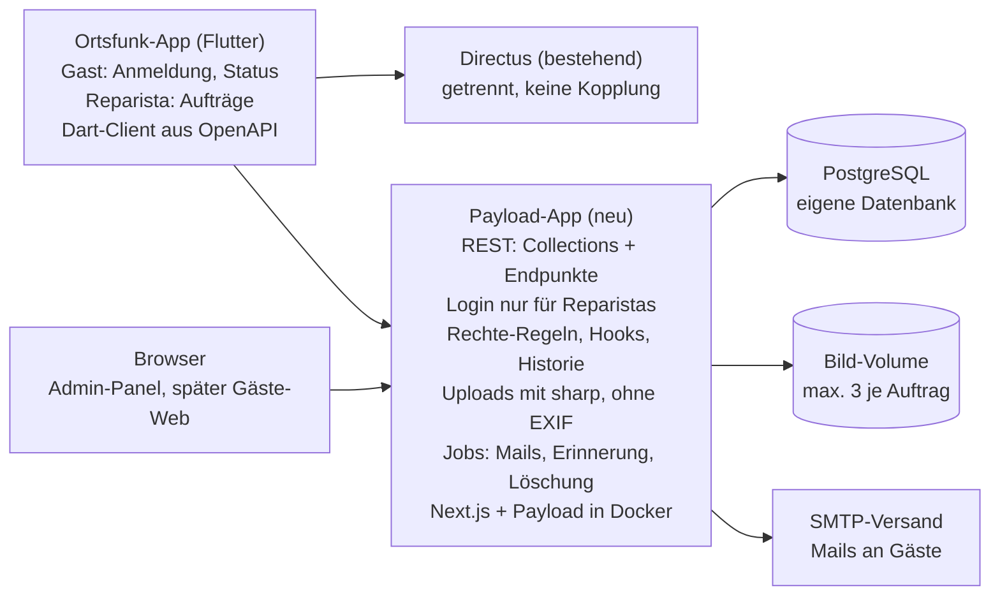
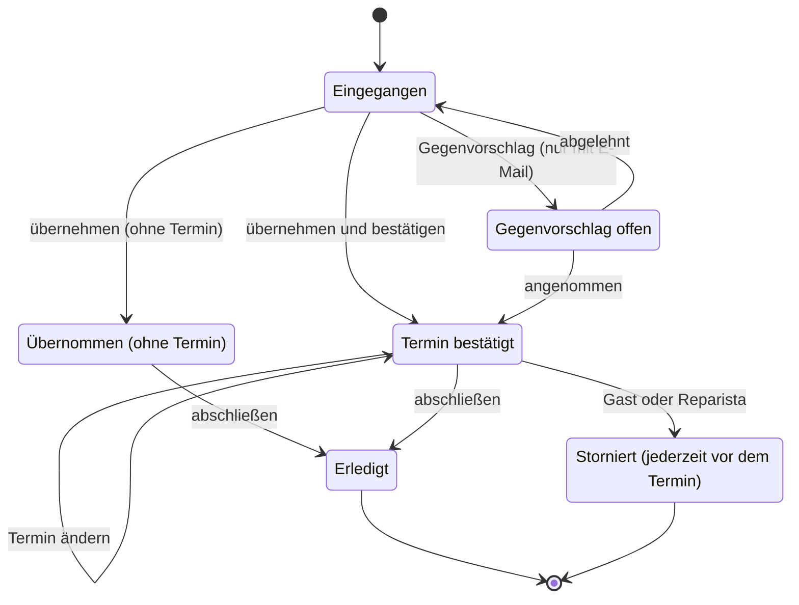

# ReparierBar – Konzept Terminanmeldung für das Repair Café Kremmen

Stand: 18.11.2026 · Heiko

## Ziel und Rahmen

Eine eigenständige Payload-Anwendung (Payload 3 auf Next.js, wie bei Beirat-dabei) nimmt Reparaturanfragen mit Gerätebeschreibung und bis zu 3 Bildern an, damit Reparistas sich vorab mit Anleitungen und Videos vorbereiten können. Sie läuft getrennt von Directus und von der Beirat-dabei-Instanz, mit eigener PostgreSQL-Datenbank. Payload liefert REST-Endpunkte, Admin-Panel, Benutzer und Uploads; die Fachlogik liegt in eigenen Endpunkten und Hooks. Die Ortsfunk-App ist das erste Frontend, jedes weitere setzt auf dieselben Endpunkte auf.

Festgelegte Rahmenbedingungen:

- Das Repair Café hat feste Termine von 10:00 bis 14:00 Uhr. Der Gast wünscht sich eine Ankunftszeit; feste Zeitfenster gibt es nicht.
- Pro Reparatur wird mindestens eine Stunde eingeplant, die letzte Ankunftszeit ist daher 13:00 Uhr.
- Wie viele Reparaturen parallel laufen, ergibt sich von selbst: Jeder Reparista sagt nur so viele Termine zu, wie er schafft. Ein bestätigter Termin heißt: Es ist jemand da.
- Wer einen Termin bestätigt oder einen Gegenvorschlag macht, wird Verantwortlicher – man meldet sich nur, wenn einem der Termin passt. Die Historie zeigt, wer wann zugesagt hat.
- Selbstanmeldung geht auch ohne E-Mail, dann aber ohne Reservierung. Trägt ein Reparista eine telefonische Anmeldung ein, darf er alle Felder setzen, auch einen bestätigten Termin.
- Die öffentliche Belegung zeigt Gerätekategorie, Hersteller und Typ, aber keine Personendaten. Kontaktdaten sehen nur der verantwortliche Reparista und Admins.

## Rollen und Rechte

Gäste müssen sich nicht authentifizieren: kein Konto, kein Passwort, kein Bestätigungsklick. Damit Fremde eine Anfrage nicht ändern können, gehört zu jeder Anfrage ein persönlicher Link; die App speichert ihn automatisch, die Mail liefert ihn mit. Nur Reparistas und Admins melden sich mit E-Mail und Passwort an. „Als Verantwortlicher“ gilt nur für Aufträge, die der Reparista übernommen hat.

| Funktion | Gast | Reparista | Admin |
| --- | --- | --- | --- |
| Belegungsübersicht ansehen (Ankunftszeit, Kategorie, Hersteller, Typ; ohne Personendaten) | ja | ja | ja |
| Anfrage mit Gerät und bis zu 3 Bildern anlegen | ja | ja, für telefonische Anmeldungen | ja |
| Wunsch-Ankunftszeit angeben (Reservierung) | nur mit E-Mail | ja, auch ohne E-Mail | ja |
| Eigene Anfrage ansehen, ergänzen, stornieren | per persönlichem Link | – | ja |
| Gegenvorschlag annehmen oder ablehnen | ja | – | – |
| Übersicht neue und übernommene Aufträge, Tagesliste | – | ja | ja |
| Wunschtermin bestätigen (wird Verantwortlicher) | – | ja, alle | ja |
| Gegenvorschlag machen (wird Verantwortlicher; nur mit E-Mail) | – | ja, alle | ja |
| Auftrag ohne Termin übernehmen, Verantwortung abgeben | – | ja | ja |
| Termin direkt ändern | – | ja, alle | ja |
| Kontaktdaten sehen | eigene | als Verantwortlicher | ja |
| Recherche-Notizen und Links ablegen und lesen | – | ja | ja |
| Historie ansehen | – | ja | ja |
| Veranstaltungen pflegen | – | – | ja |
| Aufträge inkl. Historie und Bilder löschen | – | – | ja |
| Benutzerverwaltung | – | – | ja |

## Architektur

Die App spricht wie bisher mit Directus und zusätzlich mit der neuen Payload-App; zwischen beiden Backends gibt es keine Verbindung. Die Payload-App ist eine eigene Instanz, auch getrennt von Beirat-dabei, weil hier eine Einzelperson datenschutzrechtlich verantwortlich ist. Reparistas und Admins können von Anfang an im Admin-Panel arbeiten; die Gäste-Webseite kommt in Stufe 2 in dieselbe Next.js-Anwendung.

In der Ortsfunk-App bekommt das Repair Café einen eigenen Bereich, erreichbar über das Menü oben links und als Hinweis bei den Repair-Café-Terminen unter „Events“. Gäste sehen dort Belegung, Anmeldeformular und „Meine Anmeldungen“. Der Reparista-Login liegt in den Einstellungen und schaltet die Auftragsübersicht frei.

## Technologie-Stack

Umgesetzt wird mit Payload 3, demselben Stack wie Beirat-dabei. Datenhaltung, Benutzer, Rechte, Uploads, Admin-Panel und zeitgesteuerte Jobs bringt Payload mit; selbst gebaut werden Gast-Zugang, Statuswechsel und Historie.

| Baustein | Umsetzung | Hinweis |
| --- | --- | --- |
| Anwendung | Payload 3 auf Next.js, TypeScript | gleicher Stack wie Beirat-dabei, eigene Instanz |
| Datenbank | PostgreSQL 16 über `@payloadcms/db-postgres` | Migrationen über Payload |
| Login Reparista/Admin | Auth-Collection `benutzer` (JWT bzw. HTTP-only-Cookie) | Einladung und Passwort-Reset eingebaut |
| Gast-Zugang | kein Login; persönlicher Link mit Zufallsschlüssel (256 Bit), nur Hash in der DB, geprüft in eigenen Endpunkten | Gast muss sich nicht authentifizieren |
| Fachlogik | eigene Endpunkte für Statuswechsel, Rechte-Regeln mit Abfragefiltern, Hooks | Statusfeld über die Standard-API nicht beschreibbar |
| Mail | `@payloadcms/email-nodemailer` über SMTP der eigenen Domain; Versand als Job | Wiederholung bei Fehlern |
| Zeitgesteuert | Jobs Queue mit `schedule` und `autoRun` | Erinnerung am Vortag, Löschfrist |
| Bilder | Upload-Collection mit sharp: `resizeOptions`, `imageSizes`, `withMetadata: false` | verkleinern, EXIF/GPS entfernen |
| API-Vertrag | eigene OpenAPI-Datei für die Fach-Endpunkte; Dart-Client per openapi-generator | Plugins wie payload-oapi decken die Standard-Endpunkte ab |
| Missbrauchsschutz | Rate-Limit am Reverse Proxy für Gäste-Endpunkte und Login, Zähler je E-Mail im Endpunkt, ALTCHA auf der Webseite | ohne Cookies und ohne Google |
| Betrieb | Docker Compose auf ofuk125 | wie die bestehenden Dienste |

## Datenmodell

Jede frühere Tabelle wird eine Payload-Collection, Fremdschlüssel werden Relationen. Kontaktdaten sind eine Feldgruppe im Auftrag mit eigenem Lese-Recht, damit nur Verantwortlicher und Admin sie sehen. Payload löscht abhängige Dokumente nicht von selbst mit; das übernimmt ein `afterDelete`-Hook am Auftrag.

| Collection | Wichtige Felder | Rechte und Hinweise |
| --- | --- | --- |
| `auftraege` | nummer (RC-2026-0042), status, kanal (APP, WEB, TELEFON), angelegtVon, geraetekategorie, hersteller, typ, fehlerbeschreibung, veranstaltung, wunschAnkunft, terminAnkunft, vorschlagAnkunft, dauerMinuten (60), verantwortlich, vertretungGesucht, erinnertFuer, linkSchluesselHash, ergebnis; Gruppe `kontakt` (name, email, telefon, einwilligungAm) | `status` und Termine: Update-Recht false, nur Fach-Endpunkte ändern sie; `kontakt` lesbar für Verantwortlichen und Admin; `linkSchluesselHash` versteckt |
| `bilder` | Upload-Collection; auftrag, reihenfolge | höchstens 3 je Auftrag (Hook); Dateien nur mit Lese-Recht |
| `notizen` | auftrag, autor, text, link | für alle Reparistas lesbar und anlegbar |
| `ereignisse` | auftrag, zeitpunkt, akteurTyp (GAST, BENUTZER, SYSTEM), akteur, aktion, vorher, nachher (JSON) | Historie; über die API nur lesbar, nur Hooks schreiben |
| `veranstaltungen` | datum, beginn (10:00), ende (14:00), letzteAnkunft (13:00), rasterMinuten (15), ort, anmeldeschluss, status | öffentlich lesbar, Pflege durch Admins |
| `geraetekategorien` | name, reihenfolge | öffentlich lesbar |
| `benutzer` | Auth-Collection; name, rolle (REPARISTA, ADMIN), aktiv, fachgebiete | Login, Reset, Einladung von Payload |
| `email-sperren` | emailHash, gesperrtAm | nach „Das war ich nicht“ |
| `payload-jobs` | von Payload verwaltet | ersetzt die eigene Mail-Outbox |

Eine Kapazitätsgrenze gibt es nicht. Sagt ein Reparista einen Termin zu, der sich mit einer eigenen Zusage überschneidet (weniger als `dauerMinuten` Abstand), warnt die API mit einem Hinweis. Die Belegung zeigt je Veranstaltung alle angefragten und bestätigten Ankunftszeiten.

## Auftrags-Lebenszyklus

Jeder Übergang läuft über einen eigenen Endpunkt in einer Transaktion: Status ändern, Historien-Eintrag schreiben, Mail-Job einreihen. Das Statusfeld ist über die Standard-API von Payload nicht beschreibbar, sonst ließen sich die Regeln umgehen. Bestätigen und Gegenvorschlag machen den handelnden Reparista zum Verantwortlichen.

- **Abgelehnter Gegenvorschlag:** Der Auftrag geht zurück auf Eingegangen, die Verantwortung entfällt, und ein anderer Reparista kann zusagen.
- **Termin ändern** dürfen alle Reparistas; der Gast wird informiert, die Verantwortung bleibt beim bisherigen Reparista. Die Recherche-Notizen helfen jedem, der das Gerät am Tag übernimmt.
- **Verantwortung abgeben** bei bestätigtem Termin: Der Termin bleibt bestehen, der Auftrag wird als „Vertretung gesucht“ markiert und die Admins bekommen einen Hinweis.
- **Ohne Reservierung** (Selbstanmeldung ohne E-Mail): Ein Reparista übernimmt die Recherche, der Auftrag geht ohne Termin zu Erledigt.
- **Abschließen** erfasst das Ergebnis: repariert, teilweise, nicht reparierbar oder nicht erschienen.
- **Vorschlag:** Ist eine Anfrage 3 Tage vor der Veranstaltung noch nicht bestätigt, bekommen die Admins einen Hinweis.

## Schnittstelle

Payload stellt Standard-Endpunkte unter `/api/<collection>` bereit; die Fachlogik hängt als eigene Endpunkte an den Collections oder an der Konfiguration. Statt ETags arbeiten die Fach-Endpunkte mit bedingten Updates: „Bestätigen“ ändert nur, solange der Auftrag noch Eingegangen ist, sonst antwortet er mit `409 Conflict`. Fehler kommen im Payload-Format `{ errors: [...] }`.

| Rolle | Methode und Pfad | Art | Zweck |
| --- | --- | --- | --- |
| öffentlich | `GET /api/veranstaltungen` | Standard | kommende Termine (10:00–14:00, letzte Ankunft 13:00) |
| öffentlich | `GET /api/geraetekategorien` | Standard | Auswahlliste |
| öffentlich | `GET /api/veranstaltungen/:id/belegung` | eigener | Ankunftszeiten mit Kategorie, Hersteller, Typ, Status; keine Personendaten |
| öffentlich | `POST /api/gast/anfrage` | eigener | Anfrage ohne Login; Wunsch-Ankunftszeit nur mit E-Mail; Antwort: Nummer + persönlicher Link |
| öffentlich | `POST /api/gast/das-war-ich-nicht` | eigener | aus der Mail: storniert die Anfrage und sperrt die Adresse |
| Gast per Link | `GET` · `PATCH /api/gast/auftrag` | eigener | eigenen Auftrag lesen, Beschreibung oder Kontakt ergänzen |
| Gast per Link | `POST` · `DELETE /api/gast/auftrag/bilder` | eigener | Bild hochladen oder entfernen, Vorschau abrufen |
| Gast per Link | `POST /api/gast/auftrag/vorschlag/annehmen` · `/ablehnen` | eigener | auf Gegenvorschlag antworten |
| Gast per Link | `POST /api/gast/auftrag/stornieren` | eigener | Anfrage zurückziehen |
| Login | `POST /api/benutzer/login` · `/logout` · `/refresh-token` | Standard | nur Reparistas und Admins |
| Login | `POST /api/benutzer/forgot-password` · `/reset-password` | Standard | Reset und Einladung per Mail-Link |
| Reparista | `GET /api/auftraege?where[...]` | Standard | Übersicht neu, übernommen, „Vertretung gesucht“; Kontakt nur als Verantwortlicher |
| Reparista | `POST /api/auftraege/telefon` | eigener | telefonische Anmeldung, alle Felder inkl. bestätigtem Termin |
| Reparista | `GET /api/veranstaltungen/:id/tagesliste` | eigener | alle Geräte des Tages mit Ankunftszeit und Notizen |
| Reparista | `POST /api/auftraege/:id/bestaetigen` | eigener | Wunsch-Ankunftszeit zusagen, wird Verantwortlicher; Warnung bei Überschneidung |
| Reparista | `POST /api/auftraege/:id/gegenvorschlag` | eigener | andere Ankunftszeit vorschlagen, wird Verantwortlicher (nur mit E-Mail) |
| Reparista | `POST /api/auftraege/:id/termin` | eigener | Termin direkt setzen, mit Grund (alle Reparistas) |
| Reparista | `POST /api/auftraege/:id/uebernehmen` · `/abgeben` | eigener | ohne Termin übernehmen; Verantwortung abgeben |
| Reparista | `POST /api/auftraege/:id/abschliessen` | eigener | Ergebnis: repariert, teilweise, nicht reparierbar, nicht erschienen |
| Reparista | `GET` · `POST /api/notizen` | Standard | Recherche-Links und Notizen |
| Reparista | `GET /api/ereignisse?where[auftrag][equals]=:id` | Standard | Historie, nur lesen |
| Reparista | `GET /api/bilder/file/:dateiname` | Standard | Bild mit Rechteprüfung |
| Admin | `/api/veranstaltungen`, `/api/benutzer` | Standard | pflegen, einladen, deaktivieren; meist im Admin-Panel |
| Admin | `DELETE /api/auftraege/:id` | Standard + Hook | Auftrag mit Bildern, Notizen und Historie löschen |
| Admin | `POST /api/admin/bereinigung` | eigener | alle Aufträge vor einem Datum löschen, mit `dryRun` |

Den Schlüssel aus dem persönlichen Link schicken App und Webseite automatisch im Header `X-Auftrag-Schluessel` mit. Der Gast merkt davon nichts und gibt nie etwas ein.

## Benachrichtigungen

Mails gibt es nur, wenn der Gast eine E-Mail-Adresse angibt. Jede Mail ist ein Job in Payloads Jobs Queue: Der Fach-Endpunkt reiht ihn in derselben Transaktion ein, `autoRun` versendet ihn, fehlgeschlagene Versuche werden wiederholt. Der Gast muss nichts bestätigen; gegen Missbrauch enthält jede Mail den Link „Das war ich nicht“, der die Anfrage storniert und die Adresse sperrt.

| Anlass | Empfänger | Inhalt |
| --- | --- | --- |
| Anfrage eingegangen | Gast | Nummer, Zusammenfassung, persönlicher Link, Link „Das war ich nicht“ |
| Auftrag übernommen | Gast | ein Reparista bereitet sich vor; Vorname nur, wenn der Reparista das freigibt |
| Termin bestätigt | Gast | Datum, Uhrzeit, Ort, Kalendereintrag (.ics) |
| Gegenvorschlag | Gast | neue Ankunftszeit mit Links „Annehmen“ und „Ablehnen“ |
| Termin geändert | Gast | alter und neuer Termin, Grund, neue .ics |
| Erinnerung am Vortag | Gast (Vorschlag: auch Reparista) | Termin, Ort, Hinweis „Gerät und Zubehör mitbringen“ |
| Gegenvorschlag beantwortet, Storno | verantwortlicher Reparista | was der Gast entschieden hat |

Die Erinnerung erzeugt eine geplante Aufgabe mit `schedule` (täglich 10:00 Uhr) für alle bestätigten Termine des Folgetags. Das Feld `erinnertFuer` am Auftrag verhindert Doppelversand; wird der Termin verschoben, passt es nicht mehr, und die neue Erinnerung geht raus.

Der persönliche Link hat die Form `https://repaircafe.kremmener.info/a/RC-2026-0042#t=<token>`. Der Schlüssel steht im Fragment und landet damit nicht in Server-Logs. Auf dem Handy öffnet ein App Link direkt die Ortsfunk-App; dort wird der Link im Secure Storage unter „Meine Anmeldungen“ gespeichert.

## Bilder

Je Auftrag sind höchstens 3 Bilder mit je maximal 5 MB Upload erlaubt; gespeichert werden sie verkleinert auf etwa 200–400 KB. Typenschild, Fehlerstelle und Gesamtansicht sind für die Vorbereitung meist am nützlichsten – das kann die App als Tipp anzeigen.

1. **App:** `image_picker` mit `maxWidth: 1600` und `imageQuality: 80` verkleinert schon vor dem Upload; iOS liefert dabei JPEG statt HEIC.
2. **Prüfung:** Die Upload-Collection `bilder` akzeptiert nur JPEG, PNG und WebP bis 5 MB; ein Hook lässt höchstens 3 Bilder je Auftrag zu.
3. **Verarbeitung:** sharp in Payload skaliert auf höchstens 1600 px und speichert als JPEG. `withMetadata: false` entfernt EXIF-Daten samt GPS-Position; `imageSizes` erzeugt eine Vorschau mit 400 px.
4. **Ablage:** Die Dateien liegen in einem Docker-Volume, nicht in einem öffentlichen Verzeichnis.
5. **Auslieferung:** Payload gibt Dateien nur heraus, wenn das Lese-Recht der Collection greift (Reparistas, Admins); Gäste bekommen ihre Bilder über den Gast-Endpunkt. In der öffentlichen Belegung erscheinen keine Bilder.
6. **Löschen:** Der `afterDelete`-Hook des Auftrags löscht die Bild-Dokumente; Payload entfernt dabei die Dateien.

Platzbedarf: 1.000 Aufträge mit je 3 Bildern belegen grob 1–1,5 GB.

## Datenschutz und Sicherheit

Der Dienst speichert so wenig Personendaten wie möglich und zeigt sie nur denen, die sie für die Reparatur brauchen. Verantwortlich im Sinne der DSGVO ist die Einzelperson, die den Dienst betreibt; sie braucht Impressum, Datenschutzhinweise und AV-Verträge mit Strato und dem Mailanbieter.

- **Kein Login für Gäste:** Der persönliche Link ersetzt jede Anmeldung. Sein Schlüssel liegt in der DB nur als SHA-256-Hash.
- **Datensparsamkeit:** Name, E-Mail und Telefon sind optional; ein Vorname reicht. Die Einwilligung wird mit Zeitstempel gespeichert.
- **Öffentliche Belegung:** Ankunftszeit, Gerätekategorie, Hersteller, Typ und Status. Keine Namen, keine Fehlerbeschreibung, keine Bilder. Hersteller und Typ sind auf 60 Zeichen begrenzt; das Formular weist darauf hin, dass sie öffentlich sichtbar sind.
- **Sichtbarkeit intern:** Die Feldgruppe `kontakt` ist nur für den Verantwortlichen und Admins lesbar; andere Reparistas sehen „E-Mail vorhanden: ja“.
- **Local API:** Payloads Local API umgeht Rechte standardmäßig. Die Fach-Endpunkte prüfen deshalb selbst, wer handeln darf, und nutzen `overrideAccess` nur gezielt danach.
- **Historie ohne Klartext:** Änderungen an Kontaktfeldern werden nur als „E-Mail geändert“ protokolliert, ohne alten und neuen Wert.
- **Löschfrist:** Kontakt und Bilder werden 12 Monate nach dem Termin (ohne Termin: nach der Veranstaltung) durch einen geplanten Job gelöscht. Gerätekategorie und Ergebnis bleiben anonym für die Reparaturstatistik.
- **Reparistas:** schriftlich auf Vertraulichkeit verpflichten; Passwörter verwaltet Payload als gesalzenen Hash.
- **Missbrauch:** Rate-Limit am Reverse Proxy für `/api/gast/*` und den Login, Zähler je E-Mail-Adresse im Endpunkt, ALTCHA auf der Webseite, Sperrliste nach „Das war ich nicht“.
- **Transport:** TLS am Reverse Proxy; App-Endpunkte, Admin-Panel und Webseite laufen auf derselben Domain. Logs ohne Personendaten.
- **Hosting:** Strato-Server in Deutschland.

## Betrieb und Deployment

Die Payload-App läuft als eigener Docker-Compose-Stack auf ofuk125 hinter dem bestehenden Reverse Proxy unter `repaircafe.kremmener.info`: Endpunkte unter `/api`, Admin-Panel unter `/admin`, persönliche Links unter `/a/…` und später die Webseite unter `/`.

| Container / Volume | Inhalt |
| --- | --- |
| `rc-app` | Payload 3 + Next.js (Node), mit `autoRun` für die Jobs |
| `rc-db` | PostgreSQL 16, nur im internen Docker-Netz erreichbar |
| `rc-bilder` (Volume) | Bilddateien der Upload-Collection |

- **Konfiguration** über Umgebungsvariablen: `PAYLOAD_SECRET`, `DATABASE_URI`, SMTP-Zugang, öffentliche Basis-URL, Zeitzone.
- **Erster Admin** wird beim ersten Aufruf von `/admin` angelegt, wie bei Beirat-dabei.
- **Backup:** nächtlich `pg_dump` plus das Bild-Volume ins bestehende Backup; im selben Skript alte Images mit `docker image prune` aufräumen.
- **Überwachung:** eigener Endpunkt `/api/health` für den Uptime-Check; fehlgeschlagene Mails sind in der Jobs-Collection sichtbar.

## Umsetzungsplan

Stufe 1 deckt alle genannten Anforderungen ab; Stufe 2 bringt Komfort und die Webseite. Zuerst kommen Collections und Rechte, dann die OpenAPI-Datei der Fach-Endpunkte, damit die App parallel entstehen kann.

**Stufe 1 – Kern**

1. Payload-Projekt aufsetzen (Postgres, Docker, Domain); Collections, Rechte-Regeln, Benutzer mit Rollen.
2. OpenAPI-Datei für die Fach-Endpunkte schreiben, Dart-Client generieren.
3. Gast-Endpunkte: Anfrage ohne Login, persönlicher Link, Bilder, Belegung.
4. Statuswechsel-Endpunkte mit Historie, bedingten Updates und Überschneidungswarnung; telefonische Anmeldung.
5. Admin-Panel für Reparistas: Listenansichten, Knöpfe für die Statuswechsel als eigene Komponenten, Tagesliste.
6. Recherche-Notizen und Links am Auftrag.
7. Mails und Jobs: Vorlagen, „Das war ich nicht“-Link, Erinnerung am Vortag.
8. Admin: Löschen mit Hook und Bereinigung.
9. Ortsfunk-App: Bereich „Repair Café“ mit Belegung, Anmeldung, „Meine Anmeldungen“ und Reparista-Login.

**Stufe 2 – Ausbau**

1. Webseite für Gäste ohne App in derselben Next.js-Anwendung, auch als Ziel der persönlichen Links.
2. Push-Benachrichtigungen über das vorhandene Firebase als Alternative zur E-Mail.
3. Lösch-Job nach 12 Monaten und anonyme Reparaturstatistik (spätestens 12 Monate nach Start nötig).

## Entscheidungen

Alle offenen Fragen sind geklärt; als Nächstes folgen das Payload-Projekt und die OpenAPI-Datei der Fach-Endpunkte.

| Frage | Entscheidung |
| --- | --- |
| Technik | Payload 3 wie bei Beirat-dabei, eigene Instanz; Projektname ReparierBar, Git-Repo reparierbar (18.11.2026) |
| Termine | feste Termine 10:00–14:00 Uhr; der Gast wünscht eine Ankunftszeit, keine festen Zeitfenster |
| Dauer je Reparatur | mindestens 1 Stunde, letzte Ankunft 13:00 Uhr |
| Parallele Reparaturen | ergibt sich aus den Zusagen der Reparistas, keine feste Kapazität |
| Überschneidende Zusagen eines Reparista | API warnt, verhindert aber nicht |
| Welcher Reparista kommt | offen; bestätigter Termin heißt: jemand ist da |
| Bestätigen und Gegenvorschlag | alle Reparistas; wer zusagt, wird Verantwortlicher |
| Termin ändern | alle Reparistas; die Verantwortung bleibt beim bisherigen |
| Selbstanmeldung ohne E-Mail | möglich, aber ohne Reservierung |
| Telefonische Anmeldung durch Reparistas | ja, mit allen Feldern, auch ohne E-Mail mit Termin |
| Authentifizierung Gast | keine; persönlicher Link statt Login |
| Datenschutzrechtlich verantwortlich | Einzelperson |
| Löschfrist | 12 Monate nach dem Termin |
| Öffentliche Belegung | Ankunftszeit, Kategorie, Hersteller und Typ |
| Recherche-Notizen | Stufe 1 |
| Domain | repaircafe.kremmener.info |
